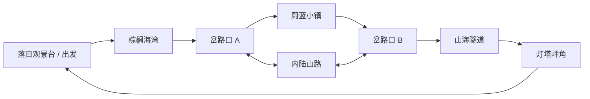

# 02 · 世界与视觉设计

版本：0.1 · 日期：2026-10-21 · 状态：视觉设计基线；按实际截图持续迭代

## 1. 美术方向

**有细节的柔和电影感海岸。** 形体与材质具有可信的尺度，车身、内饰、岩石、柏油和植被可辨认；色彩与光线经过适度理想化，海水通透，夕阳温暖，暗处仍看得清。

参考偏好来自用户对《地平线 5》的自然光影、车辆细节和驾驶感的描述。这里提取视觉与体验方向；首版以浏览器环境中稳定可玩的效果为验收依据。

| 层次 | 主要内容 | 作用 |
| --- | --- | --- |
| 近景 | 车厢、轮胎、路肩、绿植、护栏与路面细节 | 呈现质感、风和移动速度 |
| 中景 | 弯道、镇屋、隧道口、海湾、路灯和棕榈树 | 引导路线，形成有记忆的场景 |
| 远景 | 海面、岛屿、层叠山形、云和落日 | 提供开阔感与旅行氛围 |

配色建议：暖琥珀夕阳、青蓝海面、灰绿植被、奶白墙面与陶土屋顶。公路保持深灰，内饰以暖棕皮革、深色仪表和金属细节建立层次。

## 2. 区域组织

采用一片可自由开车探索的虚构海岸半岛，包含一条沿海环线和一条穿过内陆的相连支路。尺度先以几分钟能遇见不同风景为目标，通过原型驾驶时间调整。

图仅表示连通关系，路线应允许双向行驶。暂定名称不限制后续美术设计。

### 落日观景台

- 初始场景既能读懂道路，也能看见海，不以菜单遮住主要景色。
- 提供宽路肩与停车空间，适合首次操作、看车、切视角。
- 夕阳方向与车内观察角度共同设计，让车厢确实出现暖光。

### 棕榈海湾

- 参考加州海岸的开阔感，配合低矮沿海植物与棕榈树。
- 路线靠近海面，前景经过的植物形成速度和风感。
- 具有沙滩、海岸曲线和海面反光，避免整片海只有单一平面色。

### 蔚蓝小镇

- 用地中海的墙面、陶瓦与店面配合简洁的日本沿海道路设施。
- 镇内道路较窄、车速较低，有清楚的转弯和出口。
- 建筑有门窗、屋檐、遮阳篷、招牌或阳台等构成，不能只有彩色方块。
- 细节成组布置，留出路面、视野和手机渲染预算。

### 山海隧道

- 隧道有可进入的内部、连续地面、顶部、侧壁和入口边缘。
- 使用适度弯曲或出口遮挡控制揭示节奏，不让玩家从入口就完整看见外海。
- 接近出口时允许短暂明暗变化；驶出后道路前方与侧方展开海湾。
- 镜头和自动驾驶都必须穿过隧道验证，避免顶棚穿模和出洞失控。

### 灯塔岬角与内陆支路

- 岬角用独特轮廓帮助定位，并提供第二个观海停车点。
- 内陆支路有不同的坡度、植物和视野；从支路可重新并入主路。
- 不以不可见墙强迫玩家只沿一条线前进；道路以外用地形、护栏和减速提供边界反馈。

## 3. 车辆设计

| 类型 | 外观方向 | 内饰方向 | 驾驶性格 |
| --- | --- | --- | --- |
| 复古双座 | 紧凑曲面车身、圆灯、镀铬边与多辐轮圈 | 圆形机械表、皮革、细方向盘、机械手刹 | 温和、转向清楚，适合慢游 |
| 现代豪华 | 较长车身、流畅肩线、精致灯组 | 层次明确的中控、现代仪表、宽座椅与装饰条 | 平顺、稳定，巡航舒适 |
| 轻型运动 | 更低姿态、宽轮距与紧凑车尾 | 包裹式座椅、运动方向盘、清楚的转速信息 | 响应较快，制动与转向更直接 |

### 各车共同要求

- 敞篷形态从外部和车内都成立，不能用封闭车顶遮盖车厢。
- 有车头车尾、门缝、轮拱、前后灯、后视镜、挡风玻璃边框、轮胎和轮圈。
- 车内有驾驶与副驾座椅、方向盘、仪表、中控、挡杆和可辨识手刹。
- 仪表速度随车辆状态变化，方向盘和前轮随转向变化，车轮随行驶转动。
- 车身姿态可有轻微加减速俯仰和过弯侧倾，幅度以舒适为先。
- 三车的差别必须体现在轮廓和内饰结构上，不能只换车漆颜色。

先精做一辆并在车内、车外的真实驾驶机位检验，再扩展另外两辆。

## 4. 镜头语言

### 车内

视点处于合理的驾驶者眼位，默认能看到前方道路、方向盘上部与仪表。拖动观察可看副驾、中控和手刹。挡风玻璃使用轻量透明方案，避免在手机上产生昂贵折射。

观察角度设有合理边界和回正操作；默认机位不可在座椅、仪表板或挡风玻璃内部。道路起伏时避免剧烈震动。

### 第三人称

以车尾上方为基本机位，能读清近处弯道。玩家拖动可绕车观察，松手后不立即强制回正；提供明确回正按钮。跟随距离在窄屏和宽屏分别调整，保证车身与道路都有足够画面空间。

### 电影追随

初拟三个机位：侧后跟随、低位侧前、远一点的后方全景。通过平滑过渡变化，保留车辆在画面中的稳定位置。

在隧道内切到安全跟随机位；经过小镇时避免把建筑夹在车辆和镜头之间。进入时启用自动驾驶，玩家可随时退出或接管。默认不过度旋转、抖动或快速推拉。

## 5. 风与海面

- 草叶、灌木和树冠采用有相位差的轻微摆动，根部稳定。
- 棕榈叶与普通灌木的运动节奏有区别；不能整片植被像刚性物体一起平移。
- 海面同时具有大尺度色层、小尺度波纹和夕阳方向上的反光。
- 远方有地形层次与空气透视，但雾不能遮住所有远景细节。
- 手机降低植被密度和水面细节时，保留近处的风动和海面光感。

## 6. 声音设计草案

音乐方向：温暖、舒缓的器乐电台。先提供两种可切换的编排风格，例如轻爵士电钢琴和缓慢电子器乐，曲目使用原创或具备明确使用许可的素材。

| 声音 | 状态驱动 | 优先级 |
| --- | --- | --- |
| 发动机 | 油门、车速与模拟转速 | 驾驶反馈清楚，音量克制 |
| 风声 | 随车速升高，停车时回落 | 增加敞篷感，避免刺耳 |
| 海浪 | 接近海岸更明显 | 停车看海时成为主体 |
| 车载音乐 | 用户选择与音量 | 可单独关闭，暂停时停止 |
| 隧道空间感 | 进入/离开隧道 | 适度滤波或混响，出口自然恢复 |
| 界面反馈 | 切换车辆、到访地点 | 简短，避免打断放松氛围 |

## 7. 视觉评审方式

评审实际游玩画面与运动片段：桌面车外、桌面车内、隧道出口、镇内、手机横屏、手机竖屏。车辆、道路和环境不能只在独立展示页好看。

每轮记录：画面缺陷、镜头遮挡、材质可辨识度、路面读取、环境层次，以及对应的性能数据。概念图和参考图不能替代实际场景证据。
