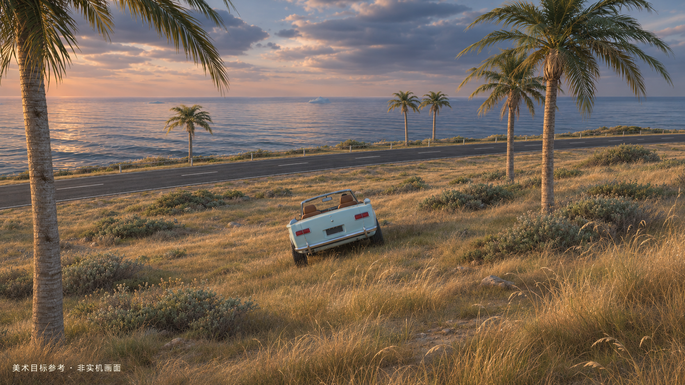

# 视觉重制：以用户实际评价为基线

## M95 · 真实细叶与镜面分级候选

按M92已确认方向，先改善真实可驾驶草坡。近草改为3–9mm宽的直叶与两段弯曲叶，12–35cm高；手机/桌面近范围保留约9.9/13.6m，窗口兼顾车与主相机，偏移最多5m。每株仍由固定世界格与种子决定，车身拨草、轮迹与恢复继续使用独立真实车辆坐标。中层草体保留，未接入M94被拒草簇图。

扩大细格使总提交增加：手机低档草层36864→102400三角形，桌面65536→147456；每实例32面不等于总预算不变。镜面只绘制原中草8面，主视图恢复32面；隐藏生境跳过叶片变形。资源失败时保留原48/64格回退预算，预留实例存储仍较大。

GPU检查发现淡出时按生境缩小尺寸会形成微米级薄面，世界浮点量化使法线不稳定。现在细叶与中草都保持尺寸，仅逐渐降低覆盖率；未放宽原法线阈值。最终四机位实际shader变换反馈通过，根误差最高38微米、道路命中0；内陆受压非根点无埋地、轮迹20/45/65秒GPU年龄恢复通过。该年龄探针不能冒充真实等待65秒。

桌面Chrome、手机尺寸Chrome/WebKit已验证主96/镜24顶点draw范围、镜面结束恢复、切档资源身份、真实驾驶/绕看与资源404回退。原生多点触控记录约27m驾驶，压力缓存增长；录屏仍有此前未定位的黑天空异常。普通无query、无录屏入口43.9m驾驶，1585帧限定天空采样未检出黑区，不据此宣称所有闪烁已修复。

M95候选已在5192提供试玩，用户一加12 Chrome自动画质反馈主画面和后视镜均流畅；5190保留M85。细草只是局部进展，实际画面仍有重复地表、孤立灌丛、粗硬中景植被和不足的远坡层次；World1.5、Lighting2.25保持，不用参考图代替实机验收。下一步优先处理可绕看代表区域的群落与草土衔接，手机新成本另行复测。

## M92 · 用户确认的新美术目标

2026-11-09，使用内置image_gen、以M89实际路肩夕阳截图为输入生成一张美术目标参考。用户确认：**“接近，就按这种自然层次和柔和夕阳推进”**。原截图、完整提示词、生成图、字节/SHA与确认范围保存在source-assets/coast-art-target-m92*。图中明确标注“美术目标参考 · 非实机画面”；不能作为发布、评分、帧率、三维形体或任何核心验收证据，也不作为游戏平面背景。

先在现有路肩与内陆草坡的一段实际驾驶示范中落实：连贯短草底层与少量弯曲高穗、成团灰绿低灌丛、自然露土间隙、根部接触与温暖但克制的夕阳。保留当前自由驾驶、道路/岸线实体、季节/昼夜/天气、镜面和手机默认横屏全屏；不为匹配参考图冻结相机、以图片遮挡世界或删减原需求。先看可实际驶入/绕看的代表区域，再扩展，避免继续零散加株或只做采样/亮度微调。

首个形体工作方向：在现有GrassCanopy预算内比较多段弯曲叶与直三角细叶。当前细叶与旧中层草体应共同检查高度、颜色和密度关系，不能靠缩短显示距离、压扁整簇或近处突然消失掩盖衔接。M89完整冠层可作为少量矮灌丛的组成，但不能据18株局部实现声称目标图已还原。每个正式改动仍需真实移动、压伏恢复、近远/质量切换和受影响设备性能证据。

## M91 · 薄叶透光工作对照

两端×灌丛/路肩×原/透光8图，分别检查.22草/蕨/新叶窄范围与.45柔性alpha植物较宽范围，共16正式图/四联图已看；均无页面/GL错误。使用原已衰减阴影的IncidentLight增加背光漫反射，不增加图片或常量环境提亮，木质新primitive排除，但混合灌丛图中细枝没有独立分割。收益不足以改变整体层次，暂不接入生产。首个观察器错误地检查未实际绘制材质的旧缓存程序，断言失败已保留；修为记录主画面实际draw后的program后才完成上述图组。未做运动/手机成本，不将参考图或单幅微亮当通过。

## M90 · 地表重复与同源表面对照，均未采用

在M89真实源码候选上做两个工作着色对照，各为两端×草坡/路肩×原版/候选8图，四张联图均已看、实际shader链接/GL0/0错误。第一组仅将原16m生成草色改为三角格随机旋转/偏移的三采样混合，导数随旋转传入textureGrad，保留原表面、覆盖、地形和群落；重复改变但整体收益微弱。第二组以原Withered Grass扫描颜色和配对法线/粗糙度统一为2m随机采样，切向法线按UV旋转的转置回转再向量混合；本候选额外请求原1k颜色，场地双采样变六采样，未称手机预算通过。

第二组在远坡读成均匀浅褐底，实体小株更零散，草土层次反而减弱；不采用，也不以“同源”或技术正确代替画面。记录在artifacts/ground-m90-{stochastic,paired-scan}/result.json，工作脚本同名；未改生产GroundMaterial、未更新5190，World1.5/Lighting2.25保持。核对M41/M48/M50历史后，不重复完整草簇烘图、整簇压扁或只近放小株的已拒方案。

## M86 · 完整低冠层与草地衔接的形体筛选开始

M85季节辐射已发布4770ca6，未解决原野稀疏小株、重复草土及岩土过渡。先做完整冠层的实际三维形体对照，不重做M74已拒绝的Didelta整家族替换，也不以M65的平贴色带代替植株体积。

已按三维/图像素材技能与恢复规则探测：Tripo、Gemini、ElevenLabs凭据均MISSING，无付费任务。采用许可明确的扫描素材作独立筛选：[Othonna Cerarioides](https://polyhaven.com/a/othonna_cerarioides)（James Ray Cock、Jenelle van Heerden）与[Shrub04](https://polyhaven.com/a/shrub_04)（Rico Cilliers）；[官方许可](https://polyhaven.com/license)为CC0。仅下载1k原生glTF/PBR与真实alpha，逐文件核对官方size/MD5并记录本地SHA，保持完整形体后再判断取舍。这些素材不能称为加州原生物种，也尚未通过实际场景或手机预算。

第一步检查原尺寸与统一参考足迹的正/侧/近地视角，保留原法线/粗糙度与完整叶片；之后只选确有体量收益的一株试实际草坡与道路机位，先作小范围混合群落，不直接整图替换或增加近景上限。未通过前5190保持M85，World1.5/Lighting2.25不升。

该形体筛选已完成：Othonna七个原生节点及Shrub04共32幅修后图、8联图全部已看，0页面/控制台/HTTP错误。第一组部分高株截顶，已保留并标无效；修后按实际包围球适配视锥、逐八角检查，32组投影最大绝对坐标.828<.94，完整入画。原尺寸和1m足迹分别记录，不以相近像素大小误称实际尺寸相同。

Othonna a–f较直立、底枝明显，不用于本轮低冠层角色；Shrub04是一排横向枝株，侧面重叠且底部稀疏，不直接当作完整灌丛。仅选g继续小范围实景试验：完整3124三角形、2材质，原生约.497×.463×.436m，冠形较圆，仍有裸枝和叶片间隙。尚未减面、加入public、取代现有家族或通过手机预算；不据独立平地图库提高风景评分。

M87先提取完整g节点，不减面或改色，保留原PBR，几何/法线/UV/索引逐项与源相同，世界顶点往返误差0。先在既有草坡和路肩两机位的工作场景加入三株小群落，与原场景切换对照；根据真实地面三角面定位，记录缩放/坐标及原相机不变。不把静态试摆当作风压、阴影缓存、LOD、物理接地或性能验收，未选定前不改试玩版。

11月9日首组实景8幅/两联图已看，两端各草坡/路肩原图与候选，实际相机矩阵一致、GL0/0错误。完整g提取为工作GLB4471412B、3124面/2材质，原数组往返完全一致、世界顶点误差0；尚未压缩纹理。三株在草坡增加少量近处叶片，但对整坡稀疏、地表重复及群落边界的收益不足，路肩又受到原长草遮挡，不能当整体层次改善或正式采用。工作脚本按相机相对位置试摆，仅据地面三角面定位；新株未加入原阴影缓存，也无风压/LOD/碰撞。下一组须先改善成片分布与视角可读性，保留原群落对照，不直接扩散这三株到全图。

M87第二组保持三株、原几何/材质/缩放，仅将群落中心改到相机NDC(.48,-.28)射线与真实地面交点；两端各两机位×原图/候选8幅和两联图已看，原相机矩阵一致、GL0/0错误。手机路肩前景叶体明显可辨，支持首组可读性受摆放/遮挡影响；但新株较暗、与原浅草及长草边界脱节，整坡仍重复稀疏，不批准发布。两端NDC落点分别记录，不能称同一世界坐标的跨设备一致性；未移除旧草或补缓存阴影，仍只是静态摆放对照。后续应评估小范围真实群落、基部覆盖与材质响应，避免仅以更近或更多植株代表整体自然景观提升。

M88先诊断偏暗来源：保持M87全部几何、坐标、缩放与原基色纹理，以独立材质克隆比较原生、仅去AO、以及粗糙度.9/金属0/法线强度.6组合。后者接近当前灌丛的材质角色，不声称能分离其中每个参数的因果。去AO仅用于诊断，不当作已修复真实遮蔽；不修改共享贴图Source，不改试玩版。先看两端实际机位再决定是否需要叶片透光或群落布局工作。

M88共16幅/两联图已看、同相机/GL0/0错误。核对原生glTF后，两材质均没有occlusionTexture；ARM供粗糙度/金属使用，不代表实际启用AO。因此去AO是假设未生效的控制，三组逐通道相同、电脑路肩仅5通道差1级，不能将差异当AO作用。组合响应改变局部像素，但未解决新株与浅草、长草边界脱节，未批准采用；不把单一偏暗解释为已找到完整原因。下一步以完整小群落和基部层次为主要美术问题，若进入正式实现，必须补真实摆放、风压、LOD一致性及预算，不继续盲调去AO。

M89进入资源准备：保留完整3124面与原两材质。两材质的金属系数不同，ARM蓝通道也非全零，不能为减少draw强行合并；只合并逐字相同的贴图资源并缩至512。基色在线性光按原alpha加权，法线加权后归一化，ARM保留通道意义；不扩张alpha或任意64格保覆盖。生成工作GLB约1.72MB，几何/法线/UV/索引往返SHA完全一致，原材质因子保留，3张共享贴图。小株不直接加入约1km世界阴影缓存，以免一texel黑块，不声称已完成新投影。

M89已接入内部源码候选：独立随机序列的三个固定小群落共18株，复用风动、坡面跟随和车辆压力，25–35m渐隐、37m剔除，不参加近景名额竞争；没有改变原植被的数量和布局算法。材质复制后恢复植物标记，共享三张图片，ImageBitmap持有到释放，晚到资源也清理。地面和风位移独立相加，局部法线使用联合Jacobian逆转置，然后走原压力法线近似。资源制作提交badc891，运行候选尚未发布5190。

验证覆盖和边界：首轮三浏览器6项中5过，WebKit真实键盘穿行25秒观察超时（已走7.76m）；只将该观察窗口延至60秒并保存失败时轨迹，WebKit两项复测均过，实际走9.47m、最接近群落中心.136m、六株根部周围留下原压力场标记。Chrome四项首轮已过；不合写为一次六项全绿，也不视为真机帧率。独立GPU读回对188个叶面法线附近的小切向位移作有限差分参考，真实坡与(.5,-.25)测试坡、三风时刻、压/未压12组最低dot .99869，平均压低.138–.150m、GL0；这是受控形变检查，不是逐根接地或几十秒恢复重验。

最新源码两端×灌丛/路肩×白昼/夕阳8图及四联图已看，另有实际鼠标旋转、键盘穿行与手刹视频和8帧联图。新增小株仍受旧长草遮挡，重复草土和空旷山坡的整体收益有限，因此World1.5、Lighting2.25保持，不更新试玩版。源1k/共享512的8图单独验证细节压缩，不混作群落验收。

同RTX4050顺序对照M85与M89，固定低档844×390、bank-inland车内/后视镜、正常风动和夕阳；每版540个完整RAF GPU查询加8秒4倍CPU节流。GPU P50/P95为6.135/8.498→6.134/7.200ms，CPU task为7894→7945ms；单轮噪声不作加速结论。新两primitive确有绘制，几何210→212、纹理56→59，主画面三角437190→455934。此机位性能未见明显上升，不外推全路线、昼夜天气或一加/iPhone性能。后续优先处理地表纹理与群落的共同尺度、基部和大形，不能继续把少量新株当作整体景观提升。

## M77 · 一段岩脚厚度工作试验

M76之后仅选灯塔开场`sandstone-cut-0`的一段约40m岩脚，复用现有岩石材质，比较封闭低坡与原版。第一版内侧/外侧都埋地、中间抬起，32幅两端白昼/夕阳四视图运行正常、同姿态，但读成零散低土包。临时可见性诊断显示约50–60%的岩脚投影仍可见，说明不足主要来自形状，而非完全被原岩体遮挡。

第二版按原岩面的三点扫描找到内边、内移嵌入，再单调退向地面；新增16幅候选与原16控制比较，全部相机/车位一致、0错误。实际封闭496面、无坏边/退化面，周界相对原岩体或地面的最高采样仍有桌面5.90cm/手机9.96cm外露；形状还形成显眼的浅色规则纹理条带，车内和近景都比原版突兀。两版均拒绝，不接入产品或更新5190，不用拓扑正常代替画面/接触验收。

原工厂、构建配方和48幅独立画面保留于工作证据；第二组联图按原比例留边，修正第一组desktop联图压宽带来的比例判断限制。未做被拒版本的运动/压力/性能验收，世界1.5、光照2.25保持。具体路径见[当前证据](../artifacts/final-evidence.md)。下一步推进文档11的F08天气，风景群落、大形与岩土过渡仍未完成，整体Goal active。

## M66 · 原生植株形体筛选，未接入

在独立平地上保留完整原几何/PBR，比较Poly Haven的[Crystalline Iceplant](https://polyhaven.com/a/crystalline_iceplant)、[Weed Plant02](https://polyhaven.com/a/weed_plant_02)、[Leipoldtia Schultzei](https://polyhaven.com/a/leipoldtia_schultzei)与[Searsia Burchellii](https://polyhaven.com/a/searsia_burchellii)。四种42幅正/侧/顶视图只是素材形体筛选；统一一米足迹的缩放都有记录，不能当实际驾驶视角或真机成本。低株冠层太疏，宽灌木仍有裸枝，未选入产品；完整大株还存在明显几何开销。旧M43成熟Searsia Lucida已有结论，不重复加工。

源码和试玩仍为M64，没有新增public模型/贴图。World1.5、Lighting2.25沿用，无新整体评分；风景问题继续保留。下一阶段推进已登记F05实际后视镜，不能以驾驶功能替代自然风景验收。原图、逐文件官方尺寸/MD5/本地SHA和筛选方法见[当前证据](../artifacts/final-evidence.md)。

## M65 · 共同覆盖工作对照未采用

先在三个紧凑群落内重排原预算中的草/灌丛，让地面vertex shader借用原草毯RG32F覆盖数据；总数、外部图像、区域外植物保持。首组16实际工作图共享数据与运行均正常，但裸土过暗、群落偏远。第二组移近坡脚并用已有宏颜色亮度过渡，另16图0错误，仍出现偏灰的平贴带，低冠层体量没有改善到可采用程度。两端全部联图已看，拒绝加入试玩。

运行源码与5190继续M64；工作配方与图留存在artifacts/habitat-m65-*，不是运动、LOD、压力、性能或正式发布验收。下一轮先检查完整贴地基部、低冠层和枯叶垫形体，再回到真实驾驶视角验证，避免只用另一层颜色或遮罩替代植物体量。

## M64 · 让道路与海岸进入同一坡面

灯塔一带共用连续8m岬角场，实际路线最高新增7.983m、最大绝对纵坡8.124%；从上坡的近路顶到下坡海景形成可见转折。地面、道路、地标和岸体一起更新，临岸岩石保留海下底脚，摄影面/闭合体同场变形。旧内陆脊谷只做少量边坡投影修正，未新增纹理或地形面数。

最终BwUp8_dq已更新5190。两端193.66/194.71m实际键盘/触控上下坡、16正式机位、三浏览器40通过/2条件跳过，以及实际岸体/道路/草根检查完成。电脑岩背往返通过；手机海湾往返通过，但三个岬角草坡引导尝试仍停滞，限制保留。具体证据与成本见文档08/09及当前验收报告。

本轮改善道路和海岸的大尺度起伏，没有解决均匀草毯上散插小株、地表灰绿斑与实体灌丛脱节的问题。World1.5、Lighting2.25沿用，不据局部形体提高总分。下一步先在原预算内比较紧凑草—低灌丛—裸土群落的共同边界与体量，避免再次展开成M58已拒绝的长条带；F05镜面和F06–F08动态世界继续登记。

## M57 · 从均匀圆坡转向连贯脊谷

M53生成草体、M54完整三维小株、M55细草增密/加宽、M56零散内陆岩堆都没有足够收益，未进入试玩版。M57保留现有海岸布局，以公开高程曲率形成东侧凹谷与后方山脊，固定道路、岸线与景点周边；独立审查推动改为两端最终格网直接约束，避免二次采样移动保护点。最终Dg2Kz38n已更新5190，实际接地、道路、互动、键盘/触控及普通入口通过。

地形层次比均匀圆坡更明确，但仍有平顶、均匀坡面、草土平贴和重复植被；World保持1.5、Lighting2.25，其余八类未重评，不给新均分。首次手机bank黑角未查明，保留原图与不复现核对，后续继续观察。先改善地形与实际低矮植被的成片关系、岩土过渡，保留开阔海景及手机流畅性；后续驾驶/灯镜/动态世界仍按文档11实施。目标工具当前usageLimited，尚未标完成。

## M52 · 让地表先有连贯草土分布

M50中草形态及M51侵蚀/加高山脊/公开高程对照均未采用：部分收益太轻，部分在保护带形成陡坡。地形、道路和植被布局保持M49。M52先以生成的干草、低地被与裸土基色替换原重复颜色；16m颜色和2m摄影微法线分工，镜像寻址缓解边缘，实际草叶仍独立风动/受压。手机512与桌面1024均已看最终场景，Dj-QjOG3已更新5190。

草地大面比均匀灰坡更丰富；近处灰绿图案仍偏平贴，与独立微法线不逐叶对应，不能代替实体植物。World仍1.5、Lighting仍2.25，其余八类未重评，无新均分。后续优先让地被颜色与实际低矮植物的体量、疏密及远近轮廓协调，继续保持干燥加州方向和现有压草恢复；不重复盲目加高山丘。

前置页面预览的纹理克隆共享Source，控制图不作为旧版基线。已用独立M49/M52构建补做三机位×两端共12图核对，保留以上窄范围判断；今后的工作贴图必须拥有独立Source，不能只检查Texture对象UUID不同。

一次只读审查的生命周期问题已修，最终三浏览器/运动/正常入口均验证，主机GPU本轮上升已记文档09。镜头遮挡、惯性/悬挂、灯/镜、四季/昼夜/天气仍在文档11，按用户要求后续实施，Goal active。

## M49 · 先让海岸树冠有完整叶片

M48多个草簇候选未带来可靠画面收益，已记录并放弃。转向驾驶时更显眼的棕榈：生成带透明间隙、叶脉与干枯边缘的四格叶图，贴在起脊弯曲的主叶轴上，两级LOD保留同一完整轮廓。第一版程序叶图过于重叠的蕉叶感与去法线实验缺陷均未发布；最终C9JfYe3-的8幅机位、实际巡航、资源失败回退和单次完整投影已检查。

树冠更饱满，但原野仍有发白中草、重复地表和裸坡，World保持1.5、Lighting保持2.25，其余八类未重评，不生成新均分；整体自然风景尚未达标。继续改善草地与地表的连续层次。用户补充的镜头避障、车辆动力学/悬挂、灯/镜和四季昼夜天气已登记文档11，按用户要求留到当前工作之后实施，Goal active。

## M47 · 用完整体积替换重复圆石

拒绝把远景礁石高度直接放大到近处，也拒绝低面数原生照片UV的拉花和拉长的尖峰。采用原比例、闭合的512面扫描形体并复用既有米制岩石表面；原数量/位置不增，岩脊旋转错开重复轮廓。最终WjARrULR已更新5190，8图与离路环顾/返回已看，源表面偏差、三浏览器、实际共享sampler和单次世界缓存均有证据。

岩石更有断裂和侧背体积，整张风景仍有重复空坡、发白中草和近远植物形态差异。World1.5、Lighting2.25保持，其余八类未重评，无新均分；下一阶段继续处理草簇的形态与地表连续层次，保留用户已确认的长草主体与几十秒轮迹恢复。Goal active，真机草地连续性/流畅度反馈仍待回。

## M46 · 为实体风景腾出预算

大尺度草土混合和压暗草色的18幅工作对照没有可靠改善，全部拒绝。实际逐物体提交归因发现，景点全海岸按材质合并导致离屏细节仍被提交；改为96m完整三角分区。几何签名一致，手机四机位减少约2.3–3.1万三角形；重新阴影缓存、8正式图、三浏览器6项与小镇连续行驶均通过，CS9TI9rj已更新5190。

本轮是开销优化，World仍1.5、Lighting仍2.25，其余八类未重评，无新均分。下一阶段优先让内陆坡面形成真实有体积的岩土/植被层次，保留干燥加州海岸和自由驾驶；不继续用暗色或更多小株代替形体。长草/矮草连续性与真机流畅度已请用户复核，等待不阻塞独立风景改进，Goal active。

## M45 · 先建立有云隙与海面层次的固定夕阳

30幅同机位天空形态对照后，采用官方Kloppenheim06原始2k/1k照片；统一天空、车漆IBL、海水与固定太阳。远海长波法线及HDR mip过滤削弱碎箔般亮线，最终8图和两端连续驾驶已看，C9gz2Cw_已更新5190。云隙光束来自固定照片，后续四季/天气/昼夜仍未进入本轮。

重看三张校准锚点与完整8图：Lighting/render由M44的2.0评为2.25，洞口/驾驶室云层与海面形成更明确的冷暖深度，方向和接触仍一致；内陆仍偏单一，World保持1.5，空坡构图自动失败不变。其余八类未重评，不生成新总均分。下一阶段优先处理裸坡与草地重复平铺、地表大尺度层次及不自然的白色草斑，让风景的实体和材质也跟上天空；不以背景替代世界形体。

## M44 · 先修复用户指出的草地断层

长草远模型与细茎近模实际覆盖量相差约92–94%，旧互斥导致靠近像整株消失；保留原主体，再叠加受限近细节。矮草中层取消车周围空洞，细叶在8m内过渡覆盖率，固定草叶保持原高，避免靠近才长出。实际源工厂128接近样本、最终GPU渐退带/接地/压力、8正式图与真实触控都已检查，DsRsS9Pk已更新5190，用户真机复核待回。

这是可见连续性的修复，不等于草地美术完成。最终图仍有发白远草、均匀裸坡及天空夕阳层次不足，World维持1.5/3，其他九类未重评。下一阶段应先让整张风景的颜色、天空与远近层次产生可见改善；保留加州干燥海岸，避免继续只增加近处小株。四季、天气及昼夜变化为用户指定的后续扩展，当前先改善固定夕阳。

## M43 · 修复完整叶形，不以组件数量冒充轮廓

一次独立只读审查发现旧两面叶方案虽保留所有组件，实际裁掉约25%叶片Alpha，细枝近18–20%/远约51%；按直径删木还会省去长支撑。该原型及两株配对成本方案全部拒绝。本轮版本保留近景全部源表面，远景照片按原三角域隔离打包，并保护全部木质部分与根边界。

单株完整模型让叶片轮廓和侧面枝条更明确，手机共享近上限2、桌面4限制开销；最终8正式图、9手机视角/指针环顾及横屏触控前进/转向/制动/倒车已检查，侧面枝叶更明确且0错误；短恢复5.08秒保持草压，长期规则不改，M41完整65秒记录沿用。不会因素材校验或数值覆盖通过提高世界评分；远草发白、空坡和海岸整体构图仍不足，继续沿用World1.5/3，其余九类不重评，Goal active。39项三浏览器专项通过，C_hraUJb已更新5190。下一阶段先消除发白远草与裸坡的突兀分界，形成草地、灌丛、裸土的连贯大尺度层次。

## M42 · 先修正代理受光，拒绝无效增密

原远灌丛存在黑色片状轮廓。分层与受影对照定位到代理颜色及整丛向上的法线；改为原模型五方向直通颜色与叶片对象法线，保留原三层模型、根点、密度和切换范围。法线缩小按原叶片coverage加权，避免透明扩散值污染方向；细枝单独保留覆盖。24项三浏览器、实际GPU数据与资源销毁验证通过，已更新5190。

追加48片内陆群落、缩短实体LOD距离、半密度追加和顶视片低角度淡出都未形成可靠的风景提升：出现扁冠或成本上升，全部不采用。世界仍1.5/3，空坡、发白远草与海岸整体构图未达标；本轮不重评其余九类或制造新均分。下一步先观察更饱满的真实灌木形体，再做草地/灌丛/裸土的大尺度层次，避免继续在现有细枝株型上盲目加数量。

2026-10-21：用户评价整体勉强60分，自然风景50分，车辆外观与内饰70分，希望两者接近满分。此前功能检查、非空截图和预算通过均不等于美术质量通过。Goal继续进行，保留用户已确认的一加12 Chrome流畅度及默认横屏全屏。

## 先完成代表性海岸

开场灯塔岬角附近优先建立可对照的真实景观：侵蚀岩壁、礁石与碎石的大小层次，灌木成片分布，裸露干燥土壤、草丛和岩石之间的自然过渡。保持加州干燥海岸与柔和夕阳，不以增加稀疏相同模型数量代替造型。

优先试用CC0扫描岩壁，离线制作适合浏览器的简化网格与LOD，检查实际轮廓、法线、UV、材质和近景细节；源高模不直接进入运行资源。记录来源、作者、许可、哈希、体积及运行时三角形。一个代表场景达到明显改善后，再扩展沿线。

## 车辆随后继续精修

三款车保持不同轮廓。改进曲面仪表台、座椅侧翼与缝线、门板层次、灯具内部结构、轮胎和轮圈；反射、皮革与金属材质服务于真实形体。逐车检查车内驾驶和副驾环顾，避免细节只在展车镜头可见。

当前内饰实图中，座椅仍有明显平板和方块感；副驾前方轮拱封板向脚部空间凸出，像一块黑色立牌。下一步以带凹陷和侧翼的闭合皮革曲面重做座垫/靠背，保留三车不同支撑形体；缩薄侧封板并与门板材质连接；仪表台增加弧面软包和仪表罩。灯具随后增加反射碗、灯芯与透明罩，保留低成本材质合批，避免增加手机纹理数量。第一人称使用独立袖管，闭合前臂开口，隐藏会遮挡视线的头部和躯干。

## 每步验证

相同实际机位留存前后截图，同时检查运动、桌面/手机预算和功能回归。手机默认流畅档保持可玩；桌面GPU或Linux WebKit帧率不能代替一加12与iPhone真机数据。每个可验证步骤提交一次，不提前宣布接近满分或目标完成。

## 岩岸结构与绘制分区

扫描代表段后仍有海陆交界过平的问题。下一步将开场两侧海岸局部开挖到海平面下，保留灯塔岬角，补入外向侵蚀岩壁与潮间礁石；植被排除裸露落差区。树干和树冠按140米空间分区实例化，使浏览器能剔除相机背面的树群，保留每株树的细节。树木使用独立固定随机序列，避免局部岸线改动无意重排全岛植被。

## 用户复核：优先修复实体岩岸与自由驾驶

2026-10-23：用户认为车辆已经可以，当前主要问题是扫描岩石侧看如纸片、海岸与陆地有间隙，以及车辆无法驶出公路。此前扫描资源和画面预算验证没有覆盖实体体积与接缝，不能视为风景验收通过。

先取消道路位置钳制，让车辆按实际地面高度驶入陆地。路肩补连续坡面，保留实体护栏、建筑、陡坡和深水边界，允许从开放路肩自由进出。巡航仍沿公路行驶，远离公路时由玩家返回公路或使用恢复功能开启。

扫描表面必须补足真实厚度、侧面、背面和埋入地面的基座，检查拓扑开放边界，不能用双面材质或限制观察角度掩盖。沿岸地表、岩体和海面用实际几何交叠封口，增加侧后方和离开公路后的观察证据。车辆精修暂停，优先完成A21/A22。

已补四个LOD的实体结构，实际键盘/双指可绕到岩壁后方再返回，接地与独立厚度射线检查通过。新的开放视野暴露手机约360k三角形峰值，超过300k预算；在开始海水进退效果前，先剔除不可见的实例，保留近景形体和密度，不把降低所有车辆/近景细节当作默认解法。自然风景质量仍需用户复核。

用户刷新复核明确回复“纸片和缝隙明显改善，能自由驶离公路”。记录为A21/A22阶段改进得到确认，整体自然风景品质仍继续迭代。当前实例优化完成后进入R16/A23，不再延后海水进退需求。

实例筛选、远景树冠和实际镜头旋转已验证，正式12机位均在预算内，公路外触控峰值仍略超目标1.5%，如实保留。接下来进入海水进退，要求水边随真实岸面移动、保留泡沫和退水后的湿润过渡；旧椭圆泡沫带会被替换。自然光照和整体地表/树木品质在该需求之后继续完善。

## 固定夕阳与世界投影（已验证并更新试玩版）

R16已接入真实局部浪面、实际岸距、水深泡沫和退水湿润材质。桌面与手机横屏生产构建均完成两周期的深度水线测量和18秒真实运行录像，湿润像素变化与上岸不到的干地对照也已验证；三浏览器海水/弱动态专项通过。海水阶段已提交37272dc，等待用户实际手机与观感复核；A23实现阶段不代表整体风景验收完成。

形体补充后仍偏平：半球填光强于低太阳照度，树木原批次未投影，手机流畅档关闭实时阴影。先在同一实际机位对照暖光/填光比例，再实现分档太阳阴影：流畅档为固定夕阳和静态世界生成一次覆盖海岸的深度图，行驶时复用；动态车辆从缓存投影排除，用接触影保持落地，车辆仍可接收沿途树影。中高档继续随车局部动态阴影，增加树木/地形投影。

地图边界、深度偏移、资源加载和切档需统一管理；资源未齐不确认缓存完成，切档后保留有效缓存。沿实际相机检查树影、隧道明暗、车内受光和远景，测量默认手机像素/纹理/GPU开销并保留降级能力。静态阴影适用于目前固定时刻；未来日照、地形或建筑改变时必须重新生成。Three.js实际安装版本已弃用PCFSoftShadowMap，将使用PCFShadowMap，避免依赖失效的软阴影选项。

海水阶段已提交37272dc。新的开发预览采用独立缓存太阳：低档仅用一次生成的世界阴影，中高档将局部动态遮挡乘到同一束主光。独立审查发现原先两束光分能量会在局部图范围外漏光，已改为一束实际主光与两层遮挡，世界遮挡始终保留，不改变实际世界实例剔除。半球填光从1.3降为0.9，主光总强度候选2.5，需要实际同机位评估。缓存投影从完整原始实例建立独立代理，排除车辆、近远树冠只选远景一套；共用原几何/材质，代理仅拥有实例缓冲，生成后立即释放。固定世界遮挡由缓存覆盖，包含主相机后方的树木；中高档局部投影只绘制正在移动的车辆，实际车身渲染前恢复节点。局部图范围外返回无遮挡，再与全局遮挡相乘，不产生额外直射光。

主岛露出地面、岩体、树木和建筑收紧低太阳光空间包围盒，排除深海底和远岛，加入车顶接收余量；地形投影显式采用正面，bias按实际深度跨度归一化。PCF1024缓存约8MB并增加颜色/深度两张纹理，接收端仍有每像素过滤成本，需要实测，不能称零开销。最终候选index-C3WyIKRn.js已经独立生产预览验证并更新5190；最终生产回归41项通过、4项按平台跳过。

首帧时序审查还发现太阳方向可能在rAF前按默认朝向缓存；现已在构造时明确固定偏移。独立生产预览4191完成三浏览器的首帧暂停冷加载检查，尚未收到首个rAF也会按同一夕阳方向生成，随后60帧缓存/矩阵不变。最终手机/桌面像素、切档、CPU/GPU对照与连续行驶已验证；正式20机位及11个附属证据通过清单检查，最终生产回归41项通过、4项按平台跳过。

性能验证发现即使深度图零重绘，PCF接收和渲染器参数也有成本。已关闭渲染器的全局阴影自动更新，只在生成缓存/局部车影时显式请求；流畅档在编译时裁掉局部阴影代码和参数，中高档保留。重复同路线4倍CPU样本仍约增加15%，不能宣称零成本或真机帧率不变。

手机自动档在流畅档持续低于40fps约5秒后停用世界投影，保留车底影、夕阳配色、海水和景物；不反复自动开关。重新手动选画质可直接恢复已有缓存，高档始终可选。该保护的时间戳模拟只验证状态转换，真实一加12与iPhone的实际开销仍需复测。正式诊断现分别提供主场景和局部阴影计数，总调用/三角形纳入同一渲染预算，不用只统计颜色pass掩盖中高档成本。

极低帧率的WebKit检查首次失败，定位到FPS平滑与降级计时误用物理限幅dt；已改用独立的真实帧间隔（最多计入1秒），保留驾驶物理步长约束。原20秒断言未放宽，修正后WebKit和Chrome均通过降级及同缓存恢复，失败trace保留。

## 自然轮廓：离岸岩岛完成阶段验证，松树待改进

光照阶段已提交b5e8392，41项有效生产回归通过。离岸圆丘现取自已有实拍礁岩的三个不同高度裁片，各492三角形、实体封底，保留原20个矩阵和后续近景随机序列。三浏览器相关11项通过、1项跳过，8机位及正常行驶验证完成，正式证据evidence-offshore-rocks.json。原型的规则岩台/尖锥已弃用，最终高度上限降低至0.45，避免锯齿尖峰。

这一步只改善远景轮廓，海岸地表仍偏单一，松树冠仍像整齐团块。接下来用带枝条的针叶簇塑造可透光冠形，先验证代表段，保持近远LOD、灰绿加州色彩、低档预算和固定树影的正确性。整体现实感目标继续，不能用闭合几何检查代替美术验收。

## M19 · 松冠形体验证与下一处地表短板

7组木枝与针叶簇已替换原多面体冠。独立审查推动补充倾斜枝簇、正确双面受光和保留alpha的mip；缓存使用完整松冠一次投影，近远LOD继续控制行驶成本。多角度、真实130–700m针叶像素、实际车身树影、三浏览器专项和连续驾驶均完成，详见文档08。单图集约1.33MiB/1纹理是明确新增成本，手机完整离路过程仍略超三角形和纹理目标。

形体改善后，代表路段仍有明显的均匀地表、草卡尖刺及植被层次不足。下一步先筛选适合干燥加州的真实草株或低矮灌丛，在一个可驶近的路段验证；按单变体三角形、纹理复用与真实行驶开销选择资源，不直接导入整个展示草场或堆积数量。松干树皮、冠形重复和较远山坡仍有改进空间，整体视觉目标继续进行。

## M20完成后：优先消除放射球灌木与三角叶

实拍弯叶低草、坡地根部、近远限额与资源回退已实现并在生产验证，仍只改善细节。实际grass-verge图中原程序化maquis像放射球，蕨叶呈尖三角，重复绿地纹理缺乏土壤/枯草层；这些比新增小草更影响整体风景。下一步优先利用已有干燥扫描灌木素材及灰绿枝条候选改善代表段的中近景轮廓，控制手机成本和纹理复用，再扩展沿线。不要因专项测试通过就给自然风景满分。

## M21后：地面与路肩的材质过渡

灰绿枝叶轮廓和远距预算控制完成，放射球已替换；实际图仍露出绿地重复、平铺碎石和过亮的单色路肩，旧程序化蕨叶仍呈尖三角。下一步优先减少覆盖扫描细节的均匀绿色混色，纠正坡地法线方向，使用已有土壤/砂砾贴图把路肩接回地面，并处理尖片蕨叶。保持原实际地形、自由驾驶与手机预算；先同机位看实际改变，不以重新染色就宣称达到真实风景。

M22将地表材质独立为实际复用的GroundMaterial，地面、洞顶、斜路肩与平路肩使用同一世界坐标材质。暖干草色只作用于扫描苔绿，保留摄影亮度与碎石颗粒；重复尺度缩小并作连续扭曲。岩石颜色、法线及粗糙度三向投影对应，各方向法线与实际坡面合成后混合，避免陡壁凹凸沿错误方向拉伸。复用原扫描素材，将已有岩石法线/粗糙度无损合成RGB/A一张贴图，从9张减到8张，相对旧版仅多1次采样；PNG增大下载量、减少约5.33MiB GPU存储，具体来源和权衡见文档06。

独立射线发现M20贴地仅包含底层terrain，未包含抬高路肩：37株可见近草中4株埋深超过20厘米，最深49.3厘米。M22直接扫描RoadMesh实际四个斜路肩三角形，近草、远草和灌木按实际最高表面求高度、坡度与垂直抬升，保留原作者矩阵、颜色和随机顺序。逐实例可见性球包含抬升与形变，初始化和压缩槽位同步三分量属性。根中心/坡度独立射线与全摆放低根检查分开验证，局部平面仍不能保证任意坡折处每片叶根精确贴合。

最终CKmKV6_p已完成三浏览器受影响检查、横屏实际双指行驶、海岸湿润和手机视口GPU检查，并更新5190。GPU近岸仍有额外成本，纹理虽减1张却仍超40目标，不宣称真机性能提升。普通入口无测试钩子、可实际开始前进，最终证据见文档08/09和artifacts/final-evidence.md。

M23已用已有Fern02较小两株替换尖三角蕨叶，近784/816、远198/197tri，均保留完整7束卷曲叶，复用原三图和作者位置/共享随机调用。近景限额、60%低档前缀、实际路肩坡度/抬升和7.5cm冠心埋深已验证；旧大株摄影植物也接入逐株剔除，保留全部原矩阵和50%前缀。侧面/顶部及实际风动已观察，三浏览器21项、十二机位、实际横屏绕岩和普通入口通过，BRkU5y8R更新5190。

M22实际绕岩环顾也暴露更大的风景短板：离路山坡几乎只有平铺土壤，植被主要集中在公路旁。后续要让枯草、低灌木以自然斑块扩展到可驶达区域，使用独立随机源，保持原作者摆放，按真实视锥/距离控制成本；不只修掉眼前三角叶就宣布自然景观完成。隧道出口山体切边过直、棕榈干纹理重复也保留为后续改进项。

M24将优先覆盖这处大面积空旷：复用实拍低草和现有远草图，在可驶入的内陆带形成有空隙的干草斑块；独立随机源与显式角度，避免重排原草/树/岩/蕨叶。道路与原野的摄影近草共享同一总限额，较远的原野草限制距离并渐隐，避免新增一整套近景预算。先比较grass-verge和绕岩山坡实际机位，再按真实手机视口CPU/三角形决定分布密度，不新增位图或依赖更多灰雾填空。

M24已完成以上分布与共用预算，42项三浏览器检查、五机位优化前后像素对照、16正式视图和实际横屏行程通过，DNiaziFM更新5190。32m单元与可见前缀上传减少初版新增成本，连续巡航CPU仍比M23高约8–9%，纹理和三角形目标仍有超额，详见文档09。

实际原野及朝内陆的环顾图仍以同一种海岸石粒纹理为主。局部小株改善了空间层次，但没有形成干草地底层；世界/材质的自然感仍不足，不能给出整体高级画质验收。M25先引入适合干燥海岸的真实枯草表面，按内陆、海边、坡面分区过渡，保持路肩世界坐标连续和原实际地形。计划合并既有地面/沙地normal与roughness腾出两张纹理槽，供干草地颜色和合并表面使用；总纹理数/1k存储保持相近，同时单独记录首次下载增加。只先做代表机位，实际GPU与行驶验证通过再推广。

M25已接入真实枯草/褐土表面，按内陆、海拔、坡面及已有宏观噪声形成连续斑块，海砂与岩面保留。原野近草另做暖干色，仍借用同一图，与路边共享48/96总限额。八张地表纹理未增加，首次下载+7.16MB；实际GPU通道验证、17项专项、十六机位、海水湿润及横屏离路完整通过，BXrxtmQy更新5190。GPU波动和CPU额外成本如实见文档09，不以局部材质修整宣布整体达标。

实际图仍有规则细线状棕榈冠、简单环状树干，尤其原野追随镜头中很显眼。M26先在现有TreeGeometry职责内调整分层冠形与折弯叶片，让顶部和侧面都有体积，保留树的作者矩阵、树根/碰撞、近远LOD和固定投影。先看一个实际代表段，再根据手机视口成本决定细节，不靠加雾或整体染色掩盖形体。隧道出口山体切边过直仍在后续清单。

M26已完成分龄冠形、立体折弯叶片及桌面远叶补密，实际多角度、风动、LOD距离像素、三浏览器树根/缓存和横屏驾驶通过，Ot5MRk8T更新5190。没有增加贴图，手机完整行程仍超预算，成本见文档09。人工感仍来自硬折小叶与均匀环纹；不把冠层变丰满等同摄影真实。下一步先改善隧道外巨大直切山面与地形过渡，再继续近景树干和叶片材质。

M27已收回过长洞口侧翼、缓和纵坡、移除39个旧占位椭球，出洞更早展开海景。审查发现的侧翼高度低估和屋顶封面错缝一并修复：实际网格查询高度、共用截面顶点、独立侧翼射线与开放边检查。十五项兼容、十二机位与连续穿越/回看通过，D82rtCAi更新5190；没有把中央通行证明当完整山体正确性。

真实图仍有硬折叶片、均匀棕榈环纹与山体大尺度面感。下一步先将棕榈树干的简单环纹换成有纤维、日晒损伤和粗糙度变化的实拍表面；已从Poly Haven官方确认Palm Tree Bark来源/作者/CC0和约1.3m尺度，仅保存在工作缓存，尚未接入运行。优先评估512²两图的细节和手机成本，再决定是否使用，不直接加高分辨率整套材质。

M28实际源图为2:1，最终保留512×1024比例，两图+1.14MB/~5.33MiB。实拍纤维/疤痕按生长方向映射，保留完整弯曲树干，修复独立审查指出的约36°UV边光照缝；三浏览器21项、十二正式图、正侧背近景和横屏实际离路/环顾通过。CPU对照约+2–3%，压力路线329400tri/52tex仍超预算，详见文档09；不以树皮细节代替整体自然感。

最新正常驾驶图中，离路内陆仍像均匀平铺地面上稀疏撒了小株，灰绿灌丛没有形成自然成片的中层体量；棕榈黑色裂口按1.3m可见重复、远山大面和硬折小叶也保留为问题。下一步优先用已有实拍灌丛在可驶入的海岸内陆形成有空隙的群落，保留原作者位置、道路通行与海景开口，按实际可见距离/近景总限额控制成本，先比较代表路段与环顾画面。

M29已实现112个灰绿群落，手机1285/桌面2115作者摆放，独立随机源与前缀，不改变原作者位置。道路侧偏置、紧密群心和更低的高宽比例改善普通驾驶中层；既有近/远枝叶和10面代理复用两图，新旧合用8/16近景总名额。回退距离与末段覆盖缺陷通过一次审查和独立GPU/实例验证修正，CPU额外成本从约13%压到约6%，详见文档08/09。

新旧实际原野、侧向、完整转身、绕岩图仍暴露宽阔均匀地面、山坡大面及灌木株型稀疏，不按局部改善宣布接近满分。下一步先分析地形和路肩的形态：手机底层网格约8m间距、较宽的道路削平带容易形成大片平台；在保留真实可驶表面和连续岸线的前提下，用局部试验改善坡地起伏、侵蚀轮廓及道路外地面过渡，再决定是否更换更紧密的灌丛素材。

本轮为世界植被的窄范围复评；已重新查看三张技能校准锚点与完整16个实际驾驶视图。按0–3档，世界层次M28 **1.5→1.5**：群落分布改善，但大面积平台与稀疏株型仍未达到2档，不能用代码/像素丰富度自动加分。其余九类未在本轮全面重评，不推导整体均分；“缺少充分构图的空地”这一自动失败仍成立。下一轮地形/路肩试验直接针对该问题，整体Goal active。

M30先添加实际截面审计和仅测试可用的固定bank-inland机位，没有改地形。audit-roadbanks读取实际地形/四路肩三角形，用独立射线测桌面/手机各287点；.18段10→30m仅升1.95/1.92m，60m才升约10.37/10.33m。BHhAb6MR候选构建和桌面/横屏手机控制图通过，已看真实内陆坡面；原D_j地形截面数值保持，5190仍M29。控制图不是采用新地形的证据；下一步局部调整后检查实际道路净空/路肩接缝、根部和驾驶。

道路审计扩为实际沥青全部顶点/三角中心4648点，最差20点另用独立射线核对；M29桌面最小路下余量12.7cm、手机8.9cm，无超过3cm的侵入。两轮试验收窄削平末段/提前抬坡、再加连续低幅起伏，保持面数且都通过路面检查，但固定视图肉眼改进不充分。全部试验撤回、截图/截面及独立候选构建保留，未推给5190；不为参数变化而采用弱改动。下一步优先比较更细叶、紧密的干燥扫描灌丛，与已有灰绿地表组合，再重新评估地形。

M31素材筛选先看官方真实预览：Wild Rooibos Bush细针叶/干枯枝团、Searsia Burchellii密小叶/扭曲木枝比原Shrub04大叶稀株更贴近目标的干燥灌丛体量；Didelta Spinosa叶较大且亮绿，暂不优先。前两者来自南非干旱区，只作为虚构海岸视觉素材，不称加州原生物种。官方CC0/作者/API信息已保存工作缓存，先检查已有LOD、完整植物分离、透明叶轮廓和近远简化成本，尚未修改运行引用或增加下载给玩家。

M74重新评估完整Didelta的低冠层体积：7幅原生形体、9幅源/简化嵌土对照后，先将同株两变体作为工作家族替换，四真实机位×两端的16图显示叶色过鲜、第二株过宽矮，未采用。一次独立审查还指出任意128格coverage会跨叶/木质，不能称正确源UV区域；修正版删除该膨胀，用未校正alpha的线性光加权mip，改真实large/medium两株9665/6446近面和2186/1592远面。只对隔离叶片做保留照片细节的减饱和/亮度，24.40万像素变化而54.27万树皮像素与原alpha不变。另16幅同机位图0错误、原摆放SHA和预算保持，但偏冷灰、整体层次收益有限，仍不采用，不新增public资源或发布。未做运动/压力/最终性能验收，不用静态计数声称真机表现；世界/光照评分保持。下一阶段转向天空和统一光照，推进文档11的F07昼夜，而非继续只换小株。

M31A最终选择完整Rooibos d/e作细叶候选，近2344/1058、远1541/736面；没有采用过重的大株a。初版远看裸枝，实测确认细针叶在mip与单侧alpha-to-coverage中丢失；分区覆盖mip、线性光颜色平均与中心化裁切后改善。进一步拒绝远档主枝截短版，锁定原木枝边界后侧面冠枝重新连贯。该素材步骤尚未修改运行引用，5190仍M29；下一步在真实内陆/道路视图与受控手机成本中决定是否采用，世界层次评分不因独立素材截图自动提高。

M32已将细叶模型接入真实道路/内陆，保留作者布局和近景总额；手机稍早转代理，实际GPU代价下降后完成三浏览器、横屏连续驾驶和正式16图，DJ93已更新5190。重新查看三张技能校准图及最终桌面原野/手机电影与近群落图，世界层次本轮仍 **1.5→1.5**：单株轮廓改善，但空旷地表、零散草杆与坡面形态仍未到2档，“缺少充分构图的空地”自动失败保留。其余九类本轮未重评，不生成整体均分。下一步以真实画面对照检查草丛轮廓保留和草灌高低关系，继续处理大块空地与坡地过渡，整体Goal active。

M33修复现有草图缩小后丢叶及远草硬消失，保留实际作者矩阵、数量与全部原预算。三浏览器27项、受控掩码/实际GPU读回、手机和桌面末段渐隐、12正式视图及真实离路/环顾通过，D54已更新5190。重新查看三张锚点与实际桌面/手机图，世界层次仍1.5→1.5，空地构图自动失败不变；其余九类未全面重评。下一轮优先在现有草系统里试验不规则成片枯草，靠近路边形成连续低层、向内陆留下自然裸土与高低错落，先看代表路段，再决定密度/LOD成本，不增加新的贴图或通用抽象。

M34先做分布试验：扩大原野草斑并使边缘有弯曲/疏密，向内陆路肩靠近，增加较低的草簇，保留少量高草与裸土间隙。只改变独立随机流的原野草摆放，不改变道路草、树木、灌丛与岩体；复用现有6面远草/3款摄影近草与共享48/96限额、距离与分桶。先比较原野/路草/电影/离路的真实机位，若仍像均匀撒点或成本过大则继续调整，不直接发布。

M34最终采用100个沿路不规则草斑与90面近景弯叶，拒绝高密度/硬X形常驻近片。主体只保有48/96实例容量，复制已绘摄影细枝，近远互斥与原cap保持；手机微小远草改85→120m，桌面225→260m保持。最终三浏览器、实际末段渐隐、12正式图和真实双指离路/环顾通过，BXl已更新5190。CPU相对M33约+8–9%，GPU尾延迟及压力预算仍有问题，详见文档09，不称真机提速。

本轮按已查看的三张锚点复评最终桌面/手机图，世界层次仍1.5→1.5：近处草叶体量更完整，远轮廓仍是过于一致的团块，山坡大片空地/大形与地表颜色还不够自然，空地自动失败保留。其余九类未全面重评，不生成整体均分。下一步先以真实干燥海岸参考校准草地与裸土的组合，让近远形态/颜色连贯，再处理坡面；不继续只靠更多小株填充。

M35先校准地表的覆盖关系。参考[NPS Point Reyes海岸草原](https://www.nps.gov/pore/learn/nature/prairies.htm)及[Leor Pantilat的Big Sur傍晚记录](https://pantilat.wordpress.com/2014/02/14/into-the-wild-on-the-big-sur-trail/)，只作构图/形色参考，不复制或分发网页照片。当前Withered Grass本地原图有完整枯草纤维，但运行色乘(.72,.66,.50)且经常只覆盖约一半内陆，碎石/苔草来源成为坡面的主要观感。先提高温和坡地的连续干草覆盖，保留非均匀裸土与陡坡岩面、低处海砂；颜色与法线/粗糙度仍用同一权重，无新图片/几何或改变地形。先看固定内陆坡/路边/电影/岸边/小镇，再决定采用；不能用变亮代替真实形体。

M35最终将该地表校准与独立GPU细草窗口组合，未采用首版均匀浅底或稀疏长针。每世界cell32片以矮草为主的薄叶，窗口只更新uniform，世界hash固定摆放/形色/风相位；低档固定世界奇偶前缀减半。独立GrassCanopy职责是GPU贴地、批次与资源生命周期，未创建通用植被框架。实际GPU顶点读回和地形三角射线验证根部/道路净空、原地风动与移窗稳定；三浏览器切档复用通过，12正式机位和50秒触控离路通过。近处体量更完整，远坡仍偏空、近远草形态仍不连贯，世界层次1.5→1.5，空地自动失败保留；不重评其余九类或宣称整体达标。用户新增车辆拨草、压伏及几十秒恢复轨迹，已加入R17/A24，下一阶段实现。

M36按R17加入车辆与植被的视觉互动：实时两侧拨开、随车身俯仰/侧倾的车底压伏、真实轮点扫出的连续倒草路径。草毯、摄影草/弯叶主体、蕨叶和矮灌木共用世界压力记录；深痕保留几十秒，浅痕更快恢复，受压法线同步改变。移窗以外的未过期记录留在CPU，绕行返回仍在原处；时钟边界保留新痕迹并清掉过期记录。没有逐叶刚体或对车身施加植物阻力，本轮范围是用户描述的可见拨开、压伏与回弹。痕迹在稀疏草地中仍较细，需随自然景观整体密度/近远形态继续校准。自然风景的总体达标结论仍沿用M35未通过，不以加入互动代替画面验收。

M37修正压伏后的坡面接触。实际GPU控制中，121个受压草叶端样本有1片低于真实三角面17.45mm，未压控制为0；最终草毯按横移后所处真实三角面托住叶端，复用已取四角，跨网格才额外采样，配套几何法线。摄影草/蕨叶/灌丛沿各自原地面坡度修正位移与法线，使用现有坡面近似。三配置实际GPU对1082个可见且移动超过1mm的叶端逐一射线检查，未再发现埋地；根部、半密度世界前缀、风动与65秒恢复控制保持。局部位移减少世界大坐标相减，未受压一般植物跳过额外变形计算。此项是接触修复，不替代自然风景密度和整体构图的后续工作。

M38–M40逐步换入有空间枝叶的扫描树、完整摄影近草、连续干草底层与中距离草带，车辆压伏接触和几十秒恢复保持；8个代表机位、三浏览器、GPU读回与触控运动均有对应原版本证据。M40采用固定草几何预算分配近/中层，未继续增加小株容量。近景突然结束的边界改善，但内陆大坡形态与海岸构图仍偏简单，株型和受光也有人工感；保留世界1.5/3及空地构图未通过，不生成新的整体均分。

后续优先从完整驾驶机位检查光照与大形，而非继续叠加近草数量。现有真实天空、环境反射、主光、地表和水面的亮度/色彩需共同校准，先保留对照再决定是否采用；任何仅靠调色却未改善真实机位的试验仍放弃。随后处理远坡轮廓、侵蚀细节与景点前中后层次，保持自由驾驶、连续实体岸线和手机默认横屏全屏。

M41将近草改为细叶三角与完整原生六草簇，在原32面草毯预算内延长近层到手机9.9m/桌面13.5m，提前衔接中层；圈状边界减轻，轮点/侧拨/65秒恢复保持。最终八机位及真实触控运动已看，正式浏览器与资源回退通过，但远坡发白团块和大片裸地仍明显，沿用世界1.5/3、空地构图未通过，其他九类不重评。光照/AgX、整簇烘图、单纯抬高山坡均未产生可靠改善，未发布。下一阶段应处理远草轮廓与连续地表/裸土的自然过渡和海岸大形，而非再增加近处小株；真机性能与用户观感继续收集。
